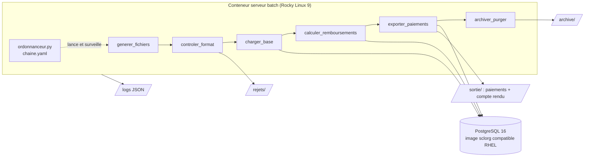

# chaine-nuit-remboursements

Chaîne batch de nuit qui traite des feuilles de soins fictives et calcule des remboursements,
avec son ordonnanceur, ses tests et son intégration continue.

## Contexte

Je suis administrateur systèmes et réseaux. J'ai construit ce projet pour montrer, sur un cas
concret, ce que je sais faire en exploitation : écrire et fiabiliser des traitements batch,
les ordonnancer, les rendre rejouables, les tester et les livrer dans des conteneurs.

Le domaine m'est familier : j'ai développé MedLiZ, une application destinée aux infirmiers
libéraux. Toutes les données sont **fictives et générées**, et les règles de remboursement sont
**volontairement simplifiées** (voir plus bas) : le sujet est l'exploitation, pas la réglementation.

## Ce que fait la chaîne

| # | Job | Rôle |
|---|-----|------|
| 1 | `generer_fichiers` | Produit les fichiers de feuilles de soins du lot, avec une part paramétrable de lignes invalides |
| 2 | `controler_format` | Valide chaque ligne, isole les rejets avec leur motif, applique un seuil de rejet |
| 3 | `charger_base` | Charge les lignes valides dans PostgreSQL (table tampon, puis remplacement du lot en une transaction) |
| 4 | `calculer_remboursements` | Calcule les remboursements en SQL standard |
| 5 | `exporter_paiements` | Produit le fichier de paiements, son empreinte SHA-256 et le compte rendu de traitement |
| 6 | `archiver_purger` | Archive les fichiers du lot et purge selon la rétention |

Chaque job :

- est écrit en shell POSIX, testé sous `ksh` et sous `bash`, vérifié par ShellCheck ;
- renvoie un code normalisé : 0 succès, 1 alerte, 2 erreur fonctionnelle, 3 erreur technique ;
- écrit des logs JSON, une ligne par événement ;
- est idempotent : le rejouer sur le même lot donne le même résultat.

Le détail des codes retour et du format des logs est dans [docs/codes_retour.md](docs/codes_retour.md),
celui des fichiers échangés dans [docs/format_fichier.md](docs/format_fichier.md).

## Architecture



Les répertoires d'échange (`entree`, `valides`, `rejets`, `sortie`, `archive`, `travail`, `logs`, `etat`)
sont sur un volume monté en `/data` dans le conteneur batch.

## Démarrage rapide

Prérequis : Docker avec Compose v2, `make`, un shell POSIX (Linux, macOS, WSL ou Git Bash).

```sh
cp .env.example .env      # valeurs factices, à adapter
make up                   # build des images, démarrage de la base et du serveur batch, schéma
make chaine               # lance la chaîne pour la date du jour (DATE=AAAAMMJJ pour un autre lot)
make statut               # état des jobs du lot
make test                 # tests bats sous ksh et bash, contre la base
make lint                 # ShellCheck
make down                 # arrêt (les volumes sont conservés)
```

Après une erreur, `make reprise` relance la chaîne à partir du job en échec.

Les logs sont consultables dans le conteneur :

```sh
docker compose -f docker/compose.yaml --env-file .env exec batch sh -c 'tail -n 20 /data/logs/chaine-*.jsonl'
```

## L'ordonnanceur

`ordonnanceur/ordonnanceur.py` lit `ordonnanceur/chaine.yaml` et lance les jobs l'un après l'autre :

- **dépendances** : chaque job déclare `depend_de`, l'ordre d'exécution est calculé par tri topologique
  et un cycle est refusé au chargement ;
- **fenêtre horaire** : aucun job n'est lancé en dehors de la plage `20:00`–`06:00`, sauf
  `--forcer-fenetre` (c'est ce que fait `make chaine`, puisqu'une démo se lance en journée) ;
- **relance automatique** : seules les erreurs techniques (code 3) sont relancées, selon `essais`
  et `delai_relance`. Une erreur fonctionnelle ne disparaît pas en relançant, elle demande une analyse ;
- **durée maximale** : un job qui dépasse `duree_max` reçoit SIGTERM, puis SIGKILL ;
- **reprise** : l'état de chaque lot est écrit dans `etat-AAAAMMJJ.json`. `--reprise` repart du job en
  échec sans relancer ceux qui ont abouti ; `--depuis-debut` rejoue tout ;
- **verrou** : un `flock` sur un fichier interdit deux exécutions simultanées de la chaîne.

Je l'ai écrit en Python plutôt qu'en shell : lire du YAML et tenir un état en shell aurait été
illisible. Il reste volontairement court et séquentiel.

### Correspondance avec VTOM et $Universe

VTOM et $Universe sont des produits propriétaires : je ne les utilise pas ici et je n'imite pas
leurs interfaces. Ce tableau rapproche les concepts de cet ordonnanceur de ceux qu'on y retrouve,
d'après leurs documentations publiques.

| Concept | Ici | VTOM | $Universe |
|---------|-----|------|-----------|
| Environnement | Conteneur batch, variables `CHAINE_*` et `.env` | Environnement | Société, nœud, espace (X, S, I, A) |
| Application / enchaînement | `chaine.yaml` | Application | Session |
| Job | Script de `jobs/` | Job (traitement) | Uproc |
| Date de traitement | `DATE_TRAITEMENT` | Date d'exploitation | Date de traitement |
| Fenêtre de lancement | `fenetre` | Plage horaire | Fenêtre de lancement de la tâche |
| Dépendance | `depend_de` | Lien entre jobs | Enchaînement dans la session, conditions |
| Ressource | Verrou de la chaîne (exclusivité) | Ressource | Ressource, condition de non-simultanéité |
| Relance automatique | `essais`, `delai_relance` | Relance automatique | Relance automatique |
| Reprise | `--reprise` depuis l'état du lot | Reprise du job en erreur | Reprise de la session à partir de l'Uproc en échec |

## Règles de remboursement simplifiées

Elles n'ont aucune valeur réglementaire :

- un taux par type d'acte : consultation et visite 70 %, acte infirmier et kinésithérapie 60 %,
  pharmacie 65 % ;
- 100 % pour une affection longue durée ;
- arrondi au centime, un paiement par assuré et par lot.

Pas de franchise, de participation forfaitaire, de dépassement ni de tiers payant.

## Tests et intégration continue

- `tests/bats/` : un fichier de tests par job et pour l'ordonnanceur, plus un test de bout en bout.
  La suite tourne deux fois, jobs exécutés par `ksh` puis par `bash`.
- `tests/donnees/` : un jeu de 10 lignes dont les résultats sont calculés à la main
  (5 valides, 5 rejets couvrant des motifs différents), voir [tests/donnees/LISEZMOI.md](tests/donnees/LISEZMOI.md).
- Le test de bout en bout couvre aussi le rejeu à l'identique (même empreinte du fichier de paiements)
  et la reprise après une panne de base pendant le chargement.
- GitHub Actions : ShellCheck, build des images, puis suite complète contre PostgreSQL.

## Correspondance avec le poste visé

| Compétence | Où la trouver |
|------------|---------------|
| Linux RHEL | Images Rocky Linux 9 et sclorg PostgreSQL, binaire-compatibles RHEL 9 |
| Unix (AIX) | Shell POSIX compatible ksh, sans extensions GNU dans les jobs (`tar` + `gzip` plutôt que `tar -z`, epoch via `awk`), pas de `pipefail` |
| Oracle / PostgreSQL | Schéma et calculs en SQL standard (`MERGE`, `CASE`, `CAST`), écarts avec Oracle signalés en commentaire |
| Ordonnanceurs | Ordonnanceur maison et tableau de correspondance avec VTOM et $Universe |
| Exploitation | Codes retour normalisés, rejouabilité, reprise, seuil de rejet, contrôle de cohérence avant publication |
| Docker / OpenShift | Images non root, données accessibles au groupe 0 (prépare la phase OpenShift) |
| Culture DevOps | Tests automatisés, CI, tout se lance par `make` |
| Supervision, Elasticsearch, Kibana, Grafana | Logs JSON prêts à être collectés ; sondes et tableaux de bord prévus (feuille de route) |

## Limites assumées

- Les jobs s'exécutent l'un après l'autre : pas de parallélisme ni de gestion multi-chaînes.
- Pas de haute disponibilité : un seul serveur batch, une seule base.
- Le mot de passe de la base passe par une variable d'environnement, visible avec `docker inspect`.
  Acceptable pour une démo locale, pas en production.
- Le SQL est écrit pour rester portable, mais il n'est testé que sous PostgreSQL.
- Les scripts respectent POSIX et sont testés sous ksh, mais pas sur un vrai AIX.
- Pas de transfert réel du fichier de paiements : il reste dans `sortie/`.

## Feuille de route

1. Chaîne batch, ordonnanceur, conteneurs, tests et CI (ce dépôt aujourd'hui).
2. Supervision : sondes au format Nagios utilisables par Nagios comme par Centreon.
3. Logs et métriques : Elasticsearch, Kibana et Grafana.
4. Compatibilité OpenShift : UID arbitraire, manifestes Kubernetes, CronJob.
5. Exploitation : scénarios d'incident et runbooks.

## Méthode de travail

Projet conçu et piloté par moi, développement assisté par IA (Claude Code), chaque composant relu,
testé et documenté.
